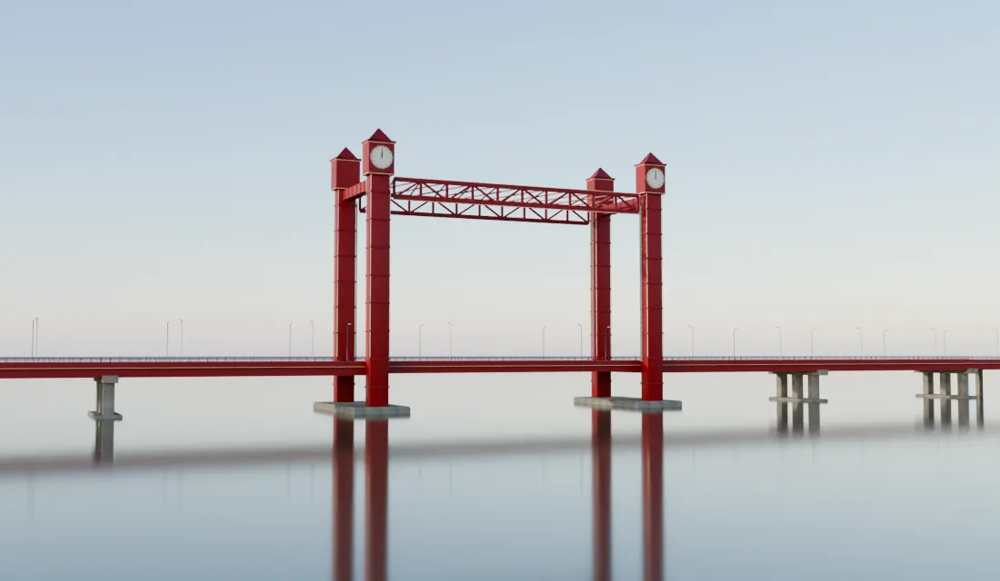
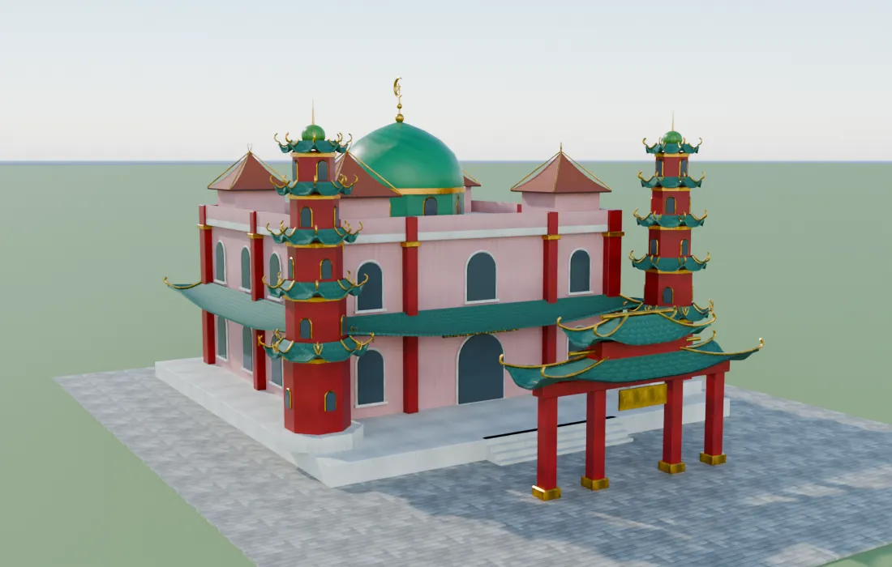
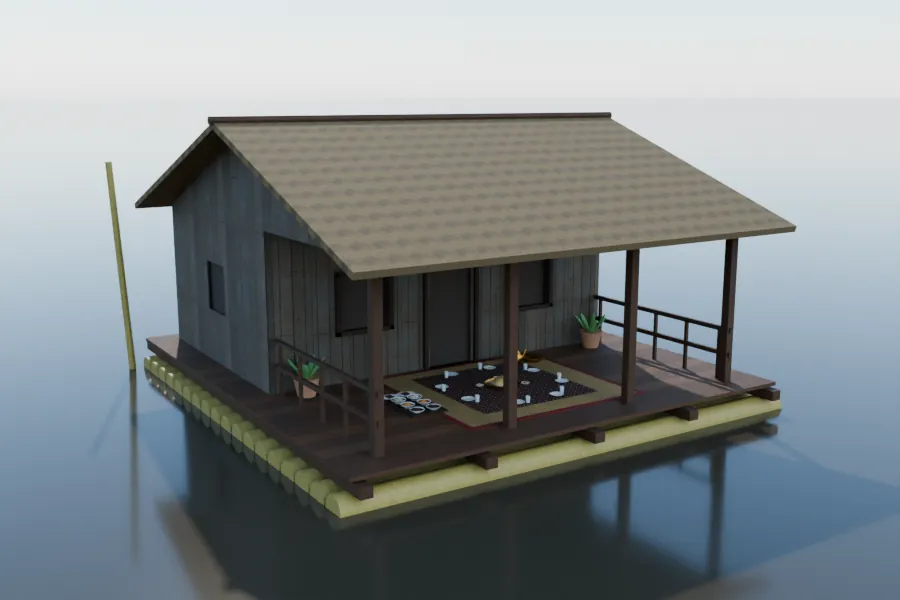
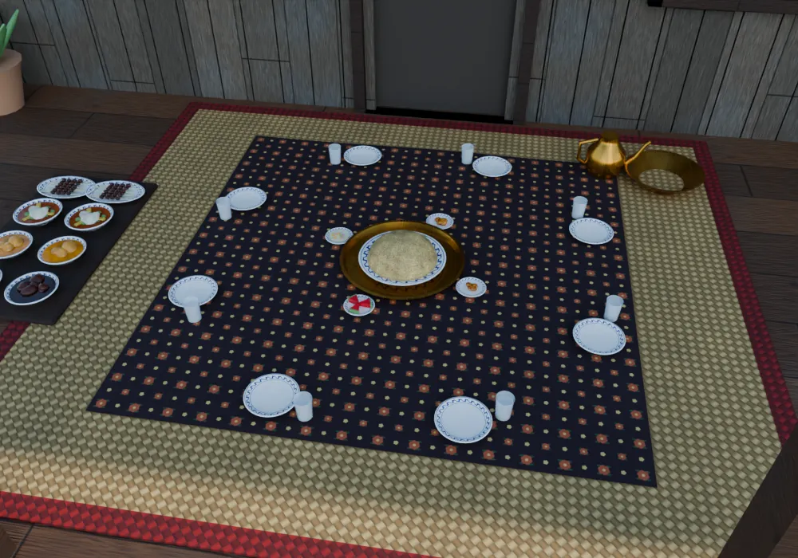
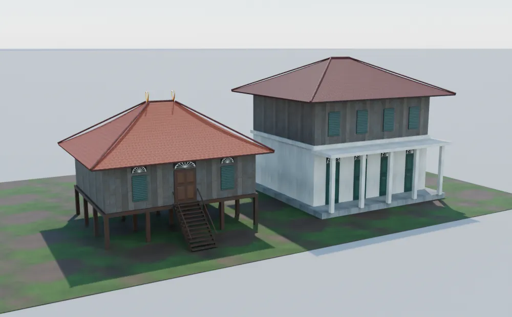
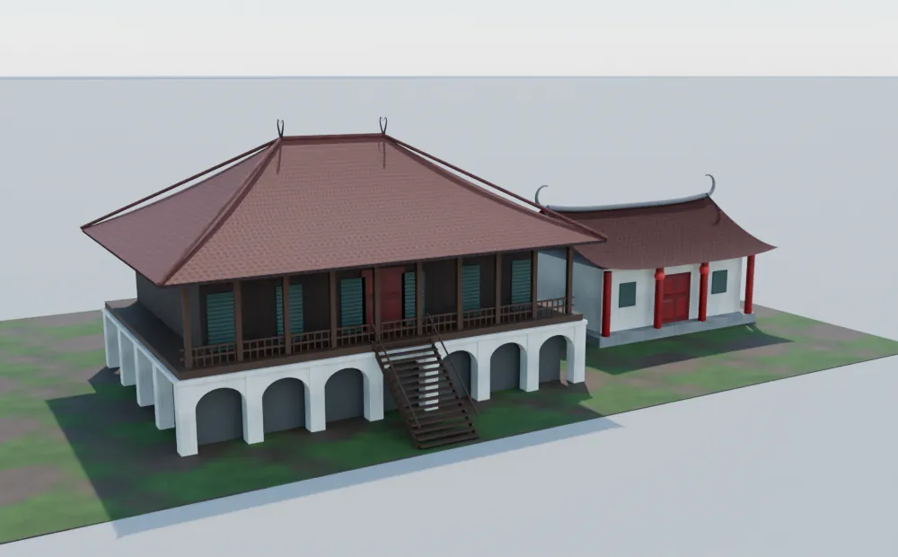
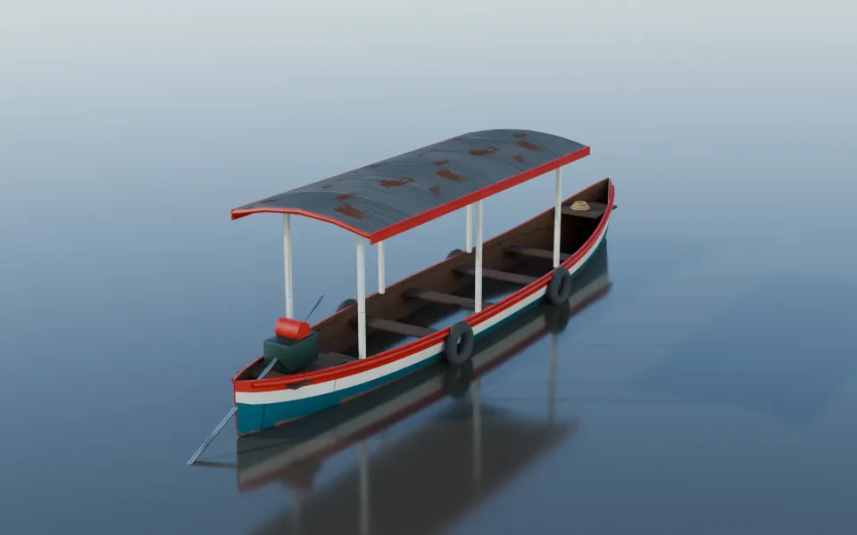
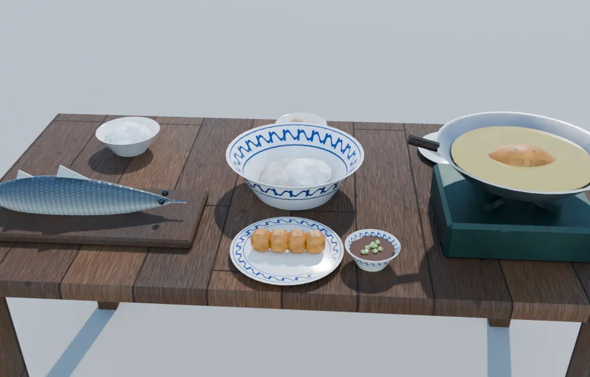

# Sila di Tepian Musi

Situs 3D interaktif tentang nilai Pancasila dalam budaya Palembang. Pengunjung naik ketek dari hilir Sungai Musi pada pukul 05.20, singgah di lima dermaga, dan tiba di bawah Jembatan Ampera saat malam. Setiap dermaga membawa satu sila dan satu hal yang bisa dicoba langsung di dalam adegan.

Proyek inovasi untuk UAS Pendidikan Pancasila (MKDU), Fakultas Kedokteran Universitas Sriwijaya, oleh Raffa Gamadan Rifandi (Pendidikan Dokter 2026).

## Lima dermaga

| Dermaga | Tempat | Sila | Yang bisa dilakukan |
|---|---|---|---|
| I. Satu Atap, Tiga Akar | Masjid Cheng Ho, 15 Ulu | Ketuhanan Yang Maha Esa | Memilih akar Tionghoa, Timur Tengah, atau Palembang dan melihat bagian masjid yang berasal darinya |
| II. Delapan di Atas Sepra | Rumah rakit, Seberang Ulu | Kemanusiaan yang Adil dan Beradab | Menata idangan ngobeng supaya delapan tamu bisa mengambil semua lauk tanpa melintas |
| III. Dua Kampung, Satu Cuko | Kampung Kapitan dan Al-Munawar | Persatuan Indonesia | Mengunjungi dua kampung, lalu memasak pempek kapal selam dari ikan sampai cuko |
| IV. Cahaya dari Ratu Sinuhun | Balai di tepian | Kerakyatan yang Dipimpin oleh Hikmat Kebijaksanaan | Membuka kitab Simbur Cahaya dan menyelesaikan sengketa batas ladang |
| V. Amanat di Atas Musi | Jembatan Ampera | Keadilan Sosial | Menggeser tahun dari 1906 sampai 2026 dan menyalakan lampu Ampera |

Cap dari tiap dermaga terkumpul di Kartu Sila yang bisa disimpan sebagai gambar atau dibagikan. Kemajuan disimpan di peramban masing-masing, tidak dikirim ke server mana pun.

## Menjalankan di komputer

Butuh Node.js 22 atau lebih baru.

```bash
npm install
npm run dev       # server pengembangan di http://localhost:4321
npm run build     # hasil statis di dist/
npm run preview   # mencoba hasil build
```

## Deploy

Konfigurasi Netlify sudah ada di `netlify.toml`. Hubungkan repo ini di Netlify, perintah build `npm run build`, folder publish `dist`.

Kalau situs dipasang di subfolder, misalnya GitHub Pages di `resvet.github.io/TepianMusi`, isi `BASE_PATH` saat build supaya semua tautan aset ikut menyesuaikan, dan `SITE_URL` supaya gambar pratinjau tautan (og:image) mengarah ke alamat yang benar:

```bash
SITE_URL=https://resvet.github.io BASE_PATH=/TepianMusi npm run build
```

## Model 3D

Semua model dibuat dari nol lewat skrip Python di folder `blender/`, memakai Blender 5 sebagai modul Python (`bpy`). Tekstur juga dibuat secara prosedural dengan numpy, jadi tidak ada aset unduhan.

```bash
# di lingkungan Python yang sudah memasang bpy
python blender/models/ampera.py      # begitu juga chengho, dermaga2 sampai dermaga4, ketek, pempek, props
                                     # tambahkan --norender untuk melewati render pratinjau
python blender/terrain_tex.py        # tekstur tepian sungai, riak air, dan buih

# kembali di folder proyek
node scripts/optimize-models.mjs     # kompres GLB ke public/models (meshopt + WebP)
node scripts/web-textures.mjs        # konversi tekstur adegan ke WebP
```

Model bangunan adalah tafsiran berdasarkan foto dan tulisan, bukan hasil pengukuran. Pengecualiannya Jembatan Ampera, yang dibuat mendekati ukuran sebenarnya.

Render pratinjau dari Blender (Cycles), sebelum dikompres untuk web:

| | |
|---|---|
|  |  |
| Jembatan Ampera dengan jam di menaranya | Masjid Cheng Ho dengan dua menara pagoda dan gerbang |
|  |  |
| Rumah rakit di atas rakit bambu | Idangan ngobeng di atas sepra |
|  |  |
| Rumah panggung dan rumah batu Kampung Al-Munawar | Rumah-rumah di Kampung Kapitan |
|  |  |
| Ketek, perahu yang dinaiki pengunjung | Meja dapur untuk memasak pempek kapal selam |

## Teknologi

- [Astro](https://astro.build) untuk halaman statis
- [three.js](https://threejs.org) untuk adegan 3D, dengan air bercermin, langit, dan cahaya yang berubah dari subuh sampai malam
- [postprocessing](https://github.com/pmndrs/postprocessing) dan [N8AO](https://github.com/N8python/n8ao) untuk bloom, tone mapping AgX, dan ambient occlusion
- [GSAP](https://gsap.com) (ScrollTrigger, SplitText) dan [Lenis](https://lenis.darkroom.engineering) untuk gerak dan gulir
- Web Audio untuk suara sungai, mesin ketek, dan efek interaksi, semuanya disintesis langsung di peramban

Kualitas grafis menyesuaikan perangkat. Jika frame rate turun, bayangan, pantulan, dan ambient occlusion dikurangi otomatis.

## Aksesibilitas

- Semua kontrol bisa dipakai dengan papan ketik. Di dalam interaksi, panah memutar kamera, `+` dan `-` mendekatkan atau menjauhkan, dan `Esc` kembali ke perjalanan.
- Jika `prefers-reduced-motion` aktif, gulir halus dimatikan dan kamera berpindah tanpa animasi.
- Tanpa WebGL, halaman tetap bisa dibaca lengkap dengan gambar diam setiap dermaga.

## Aset dan lisensi

- Model, tekstur, dan suara: karya sendiri.
- Ikon antarmuka: [Solar](https://icon-sets.iconify.design/solar/) oleh 480 Design, lisensi CC BY 4.0, lewat Iconify.
- Huruf: Newsreader dan Plus Jakarta Sans (SIL Open Font License), lewat Fontsource.
- Sumber sejarah dan budaya untuk setiap dermaga dicantumkan di halaman situs.
